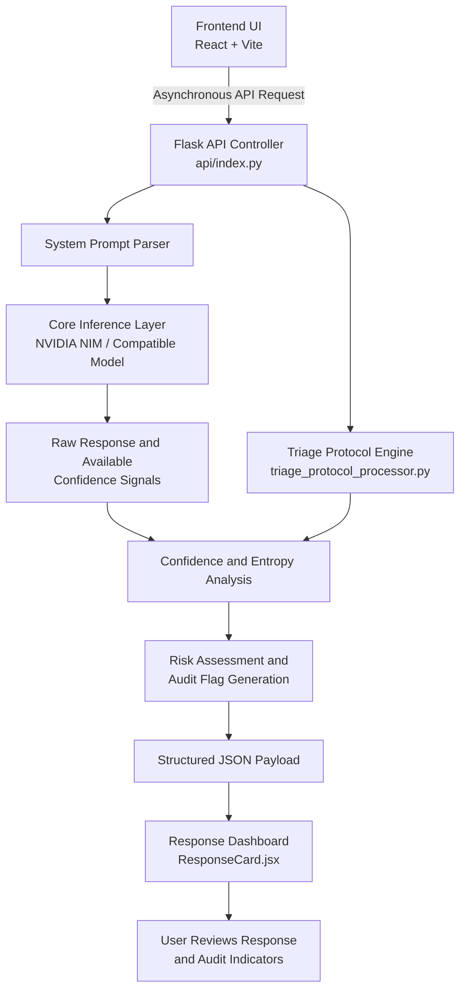

# Episteme AI

> **Operationalizing AI Public Policy Frameworks Through Decoupled Metacognitive Calibration Layers**

[](#-licensing-and-usage-restrictions)
[](https://www.python.org/)
[](https://react.dev/)
[](https://www.nvidia.com/en-us/ai/)
[](#-research-and-calibration-results)

---

## Table of Contents

- [Overview](#-overview)
- [Public Policy Context](#-public-policy-context)
- [Research and Calibration Results](#-research-and-calibration-results)
- [System Architecture](#-system-architecture)
- [Core Components](#-core-components)
- [Installation and Setup](#-installation-and-setup)
- [Verification and Evaluation](#-verification-and-evaluation)
- [Limitations](#-limitations)
- [Licensing and Usage Restrictions](#-licensing-and-usage-restrictions)

---

## 🏛️ Overview

Modern large language models (LLMs) can produce factually incorrect answers with the same linguistic confidence as accurate ones. This mismatch between expressed confidence and actual correctness creates challenges for deploying generative AI in high-stakes environments.

**Episteme AI** is a research-oriented AI auditing platform designed to make model uncertainty more visible through a decoupled calibration and triage layer. Rather than relying exclusively on a model's generated response, the system analyzes available confidence signals, evaluates potential risks, and surfaces structured audit indicators before users act on an answer.

The project explores how AI safety principles and public policy frameworks can be translated into reproducible engineering mechanisms.

### Target Applications

- **Healthcare:** Flagging potentially unsafe conclusions when critical patient information is missing.
- **Legal and Civic Systems:** Identifying responses that require statutory verification or qualified legal review.
- **Infrastructure and Engineering:** Highlighting technical recommendations that require validation against authoritative specifications.

> **Important:** Episteme AI is a research prototype, not a certified clinical, legal, or engineering decision system. Its risk flags and confidence estimates do not establish factual correctness or guarantee the prevention of harmful outputs.

---

## 📈 Public Policy Context

Episteme AI explores the technical implementation of principles associated with trustworthy AI, algorithmic accountability, transparency, and human oversight.

Relevant policy references include:

- [NIST AI Risk Management Framework](https://www.nist.gov/itl/ai-risk-management-framework)
- [White House Executive Order 14110](https://www.federalregister.gov/documents/2023/11/01/2023-24283/safe-secure-and-trustworthy-development-and-use-of-artificial-intelligence) — historical policy context; subsequently revoked in January 2025.
- [OECD AI Principles](https://oecd.ai/en/ai-principles)

The system investigates how these broad principles can inform practical mechanisms for uncertainty reporting, risk-based review, and auditable model behavior.

The central design question is:

**How can an independent computational layer identify potentially unreliable AI responses and communicate uncertainty before those responses are used in consequential decisions?**

---

## 🔬 Research and Calibration Results

Episteme AI was evaluated using a benchmarking dataset containing **790 domain-specific samples** spanning healthcare, public infrastructure, and legal decision-making scenarios.

The following figures represent the reported baseline evaluation and audit-pipeline results for this experiment.

### Reported Baseline Metrics

| Metric | Baseline Result | Interpretation |
|---|---:|---|
| Expected Calibration Error (ECE) | `0.6431` | Substantial mismatch between confidence and empirical accuracy under the evaluation setup |
| Maximum Calibration Error (MCE) | `0.9168` | Large calibration error in at least one evaluated confidence bin |
| Brier Score | `0.4477` | Baseline probabilistic prediction error |
| Negative Log-Likelihood (NLL) | `1.1229` | Baseline penalty for assigning probabilities to observed outcomes |
| Overconfident Cases | `267 / 790` | Approximately 33.8% of evaluated samples |
| Audit-Flagged Samples | `505 / 790` | Approximately 63.9% of evaluated samples |

### Interpreting the Results

**1. Calibration error**

The reported ECE of `0.6431` indicates a substantial discrepancy between predicted confidence and observed correctness under the chosen binning and scoring methodology. The precise interpretation depends on how confidence scores, correctness labels, and calibration bins were defined.

**2. Maximum calibration error**

The MCE of `0.9168` indicates a particularly large calibration gap in at least one evaluated bin. Because MCE is sensitive to bin sizes and outliers, it should be interpreted alongside ECE and reliability diagrams.

**3. Overconfidence detection**

The evaluation identified 267 samples classified as overconfident. This represents approximately 33.8% of the 790-sample dataset, based on the reported classification procedure.

**4. Audit pipeline**

The pipeline marked 505 samples for additional review, corresponding to approximately 63.9% of the dataset. This is an **audit-flagging rate**, not a demonstrated 63.9% reduction in harmful outputs.

### Research Validation Priorities

To establish the effectiveness and reproducibility of the approach, future evaluations should include:

- Reliability diagrams and confidence-bin counts.
- Explicit definitions of correctness, overconfidence, and audit thresholds.
- Before-and-after calibration metrics.
- Precision, recall, and false-positive rates for risk detection.
- Ablation studies comparing individual components against the baseline.
- Evaluation on held-out datasets and previously unseen domains.

*The reported metrics describe the supplied experimental results. They should not be interpreted as independently verified findings or proof of real-world safety improvements without supporting evaluation artifacts.*

---

## 💻 System Architecture

Episteme AI uses a decoupled frontend and backend design. The frontend presents responses and audit indicators, while the backend coordinates inference, telemetry processing, and structured output generation.



### Processing Pipeline

1. **Request intake:** The React frontend submits a user query to the Flask API.
2. **Inference coordination:** The backend prepares the model request and invokes the configured inference service.
3. **Signal extraction:** The system collects the response and any supported confidence-related metadata.
4. **Uncertainty analysis:** Available signals are processed to calculate or estimate uncertainty indicators.
5. **Triage and audit:** The protocol engine evaluates configured rules and determines whether the response should be flagged for further review.
6. **Structured output:** The backend returns a JSON payload containing the response and relevant audit information.
7. **User-facing presentation:** The frontend displays the answer, epistemic indicators, and recommended verification steps.

**Design principle:** Calibration and triage are separate from the core language-generation process, allowing audit logic to evolve independently of the underlying model.

*Actual signal availability depends on the selected inference provider and model API. Token entropy, token probabilities, and verbalized confidence are distinct signals and should not be treated as interchangeable.*

---

## 🧩 Core Components

| Component | Responsibility |
|---|---|
| `frontend/src/App.jsx` | Manages the main user interface and asynchronous API requests |
| `api/index.py` | Exposes the backend API, including the `/api/ask` endpoint |
| `triage_protocol_processor.py` | Processes confidence telemetry and applies configured triage rules |
| `frontend/src/components/ResponseCard.jsx` | Displays responses, epistemic indicators, and review recommendations |

### Key Engineering Concepts

- **Decoupled inference auditing:** Separates model generation from downstream evaluation.
- **Confidence telemetry:** Uses available model outputs and metadata to characterize uncertainty.
- **Risk-based triage:** Routes selected responses toward additional verification.
- **Structured API contracts:** Keeps backend processing and frontend rendering modular.
- **Reproducible evaluation:** Supports systematic measurement of calibration and flagging behavior.

---

## 🛠️ Installation and Setup

### Prerequisites

Ensure the development environment includes:

- Python 3.10 or later.
- Node.js 18 or later and npm.
- Git.
- Valid API credentials for the configured inference provider.
- Model/API support for the confidence metadata required by your implementation.

### 1. Clone the Repository

Replace the repository URL below with the actual repository URL.

```bash
git clone <YOUR_REPOSITORY_URL>
cd <YOUR_REPOSITORY_DIRECTORY>
```

### 2. Configure the Backend

If the backend has its own directory:

```bash
cd backend

python -m venv venv
```

Activate the virtual environment.

**macOS / Linux**

```bash
source venv/bin/activate
```

**Windows PowerShell**

```powershell
.\venv\Scripts\Activate.ps1
```

Install dependencies:

```bash
pip install -r requirements.txt
```

Configure the environment variables required by your inference provider. For example, if your implementation uses an API key:

```bash
# macOS / Linux
export MODEL_API_KEY="your-api-key"
```

```powershell
# Windows PowerShell
$env:MODEL_API_KEY="your-api-key"
```

Use the actual variable names expected by your backend. Never commit API keys or other credentials to version control.

Start the backend using the entry point configured by your project. For example, if `api/index.py` exposes a Flask application:

```bash
python api/index.py
```

If the project uses a different Flask entry point or deployment configuration, follow that configuration instead.

### 3. Configure the Frontend

Open a separate terminal:

```bash
cd frontend
npm install
npm run dev
```

Open the local development URL printed by Vite in the terminal.

Ensure that the frontend's API configuration points to the running backend, or configure a Vite development proxy if required.

---

## ✅ Verification and Evaluation

After starting the frontend and backend, verify that the application behaves as expected.

### Functional Checks

- [ ] The frontend loads successfully.
- [ ] The backend starts without configuration errors.
- [ ] The `/api/ask` endpoint accepts a valid request.
- [ ] The configured model returns a response.
- [ ] Available confidence metadata is handled correctly.
- [ ] The triage processor generates the expected audit fields.
- [ ] The frontend renders the response and audit indicators.
- [ ] Missing or malformed metadata is handled safely.
- [ ] API failures and timeouts produce useful error messages.

### Calibration Evaluation

For reproducible research, retain the following artifacts:

1. The benchmark dataset and its version.
2. Model identifiers and inference configuration.
3. The definition of each confidence score.
4. The correctness-labeling procedure.
5. Calibration-bin definitions and sample counts.
6. The ECE, MCE, Brier score, and NLL calculation code.
7. The audit threshold configuration and confusion matrix.
8. Results from repeated runs and held-out evaluations.

Where possible, compare the baseline model against the audited system using identical inputs and evaluation conditions.

---

## ⚠️ Limitations

Episteme AI is an experimental auditing framework. Its indicators have important limitations:

- **Confidence is not correctness.** A confident answer may be correct or incorrect, and a low-confidence answer may still be accurate.
- **Entropy is not a universal hallucination detector.** Token-level uncertainty does not independently establish whether a claim is factually grounded.
- **Calibration is model- and dataset-dependent.** Performance on one benchmark does not guarantee performance on another domain or deployment setting.
- **Flagging does not eliminate risk.** Audit rules can miss harmful responses or flag safe ones.
- **Human review remains important.** High-stakes decisions require appropriate professional oversight and authoritative verification.

The system should not be deployed as an autonomous clinical, legal, structural engineering, or public-safety decision-maker without domain-specific validation and appropriate safeguards.

---

## 📜 Licensing and Usage Restrictions

Episteme AI is intended for local evaluation, research, and peer verification, subject to the project's applicable license and usage restrictions.

Before using, modifying, redistributing, or deploying this software:

- Review the repository's license and documentation.
- Confirm the permitted uses of the code and benchmark data.
- Verify the licensing requirements of third-party models and dependencies.
- Do not assume that a custom evaluation license permits unrestricted commercial use.
- Document material modifications and evaluation results when sharing research findings.

If the repository contains a separate license file, consult that file for the authoritative terms.

---

## 🎯 Project Objective

Episteme AI investigates how independent uncertainty analysis, structured auditing, and risk-based triage can make AI systems more transparent and easier to evaluate.

Its central objective is not to make AI appear infallible, but to make uncertainty and potential failure more visible, measurable, and actionable.

**Build systems that communicate not only what they predict, but also when their predictions deserve closer scrutiny.**
